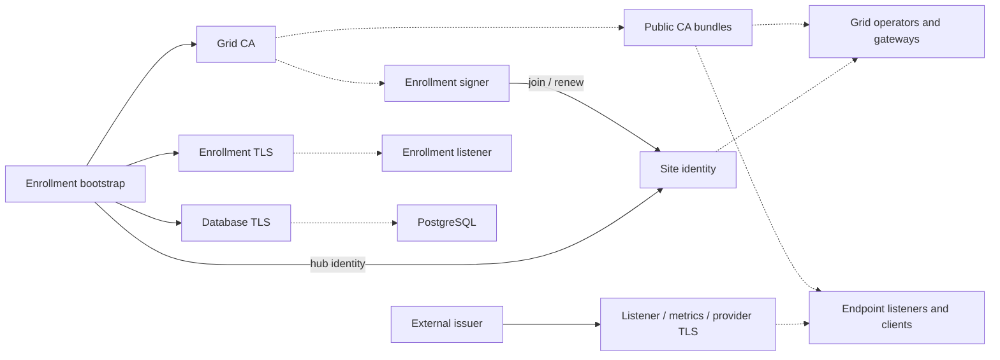

# Certificate ownership and rotation

Certificate roles generated or consumed by AI Grid Network (AGN). Each page
identifies storage, issuer, writer, consumers, validity, rotation, and reload.
Names below are chart defaults and can be overridden.

## Certificate index

| Certificate or material | Default validity | Rotation owner | Renewal trigger |
| --- | --- | --- | --- |
| [Grid CA](grid-ca.md) | 3,650 days | Administrator or external PKI | Explicit replacement |
| [Enrolled and hub site identity](site-identity.md) | 180 days | Grid operator and enrollment signer | One-third of validity remains, if enabled and using SPIFFE trust |
| [Enrollment serving TLS](enrollment-serving.md) | 365 days | Administrator invoking bootstrap, or external issuer | Bootstrap execution within 30 days of expiry or when material is invalid |
| [Built-in database TLS](database-serving.md) | 365 days | Administrator invoking bootstrap | Same bootstrap checks as enrollment serving TLS |
| [Fallback CA and site identity](fallback-certificates.md) | CA 3,650 days, leaf 365 days | Administrator | No automatic renewal |
| [Gateway listener TLS](gateway-serving.md) | Issuer-defined or reused site validity | Selected issuer or site-identity renewal owner | Issuer policy |
| [Operator and gateway metrics TLS](metrics-serving.md) | Issuer-defined or reused site validity | Selected issuer or site-identity renewal owner | Issuer policy |
| [Provider and external endpoint TLS](provider-tls.md) | Issuer-defined | Endpoint/client identity owner | External renewal policy |
| [CA bundles and public copies](ca-bundles.md) | Original certificates' dates | Issuer plus distribution owner | Source or trust-policy change |
| [Test certificates](test-certificates.md) | Generator- or fixture-defined | Test maintainer | Explicit regeneration or test setup |

See [installation order](installation-order.md) for prerequisites and the
proposed Helm bootstrap gate.

## Issuers and consumers

Solid arrows issue certificates. Dotted arrows consume certificates or trust.
Bootstrap and enrollment both sign with the Grid CA.



## Validity and rotation

- Lifetime means expiry after issuance. Grid generators backdate the start by
  one hour. Enrollment-issued identities use five minutes. The encoded validity
  interval includes that allowance.
- A certificate's dates do not guarantee continued acceptance. CA validity,
  trust configuration, names, and peer policy also apply.
- Renewal issues a replacement certificate. Reload makes a consumer use changed
  material. A successful Secret update establishes neither consumer reload nor
  successful TLS communication.
- Helm bootstrap runs on install and upgrade. No scheduled controller renews the
  bootstrap serving or database certificate between executions.
- External issuers set their own lifetimes. Read the issued certificate's dates
  and the issuer's renewal policy for a deployed installation.

To inspect a public PEM certificate:

```console
openssl x509 -in certificate.pem -noout -subject -issuer -dates
```

SWIM keys, invitation tokens, service-account tokens, API keys, and database
passwords are credentials with separate lifecycles. They are not certificates.
