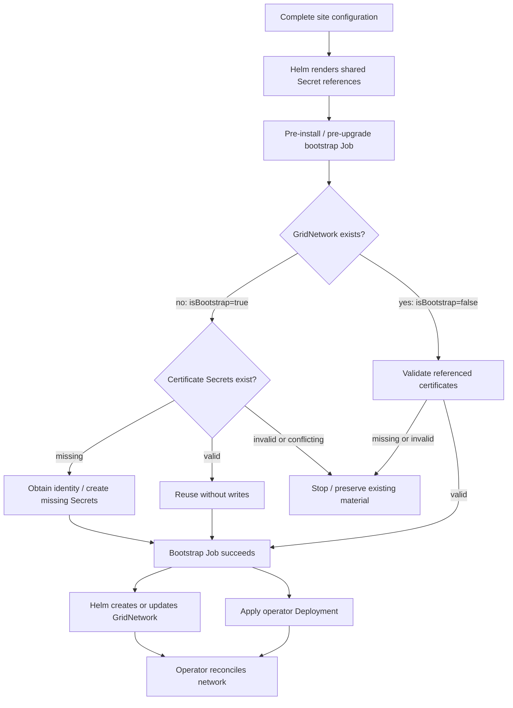

# Certificate prerequisites and installation order

GridNetwork contains certificate references, not certificate contents. Its
creator and the certificate writer must use the same Secret names and namespace.

## Current behavior

| Component | Creates or updates |
| --- | --- |
| Enrollment bootstrap hook | Grid CA, serving and database TLS, optional hub identity |
| Helm client or GitOps controller | GridNetwork from configured chart values |
| Joining operator enrollment task | Site identity and local public CA Secret |
| Running Grid operator controllers | GridNetwork status and generated routing state |

The operator chart renders GridNetwork when grid.id is set. Its TLS references
come from enrollment.identitySecretName, enrollment.caSecretName, and the
release namespace. The chart can populate those references before the Secrets
exist.

The operator runs enabled enrollment before starting its network controllers.
Enrollment reads the existing network's Secret references or uses configured
default names. It does not create GridNetwork or attach missing references
later.

## Proposed Helm bootstrap gate

This gate is proposed work. The existing joining-site chart does not implement
it.

| Stage | Required inputs / completion |
| --- | --- |
| Prepare | Namespace, hook ServiceAccount/RBAC, and established Grid CRDs |
| Configure | Grid ID, site identity, gateway references, peer settings, trust mode, and Secret names |
| Detect | Job reads the intended GridNetwork. Not found means first-time site initialization |
| Validate existing material | Certificate/key match, expected site and issuer, valid dates, and required trust/key Secrets |
| Obtain identity | Only for first-time initialization: reuse valid material or obtain missing material from the configured signer |
| Create missing Secrets | Create only. Never update, patch, or delete an existing certificate Secret |
| Apply network | Hook succeeds. Helm applies the fully configured GridNetwork and operator resources |
| Reconcile | Operator starts with the referenced identity and maintains status and routing state |

## Bootstrap detection

The Job computes isBootstrap from the live API. An absent GridNetwork means
first-time initialization of this site. An existing network skips initial
issuance. API failures and missing CRDs must not be treated as an absent
network.

This detection does not choose the Grid CA authority. Every joining cluster also
starts without GridNetwork. Install configuration must identify an existing
signer or explicitly select new-grid creation.

An incomplete existing network requires explicit configuration repair. Its
existence does not prove its TLS references or certificates are valid.

This gate applies to initial site identity provisioning. The enrollment chart's
serving/database renewal checks still run on its install/upgrade lifecycle.

## Certificate preservation

The proposed site bootstrap checks certificate Secrets independently of
GridNetwork. A missing network never authorizes replacing existing certificates.

| Existing material | Bootstrap action |
| --- | --- |
| Valid certificate, key, and expected trust | Reuse without writing to the Secret |
| Missing Secret | Create only when compatible with existing material and the configured signer |
| Incomplete Secret, expired certificate, or identity/trust mismatch | Stop and preserve existing material for explicit repair |
| Secret appears during creation | Read and validate it. Reuse if valid, otherwise stop |

Bootstrap must not generate a replacement CA to complete a partial installation.
Reruns after interruption preserve certificates already written. Renewal and CA
replacement remain separate operations owned by the documented rotation owner.

## Ordering constraints

- An enrollment service used by the hook must already be reachable. A hook
  cannot enroll through a service that its own release has not started yet.
- Helm renders before running hooks. Shared names work in one pass. A field that
  depends on generated output needs another render or a separate object writer.
- Missing required input should prevent network creation through render-time
  validation or hook failure. Preserve the existing network on an upgrade
  failure.
- CRDs in this chart are templates. Establish them before applying GridNetwork.
  The existing chart documents a first install followed by an upgrade with
  grid.id.
- An init container alone cannot delay a separately applied GridNetwork. If used
  as an additional startup check, it must not wait for certificates the main
  operator is responsible for creating.
- GitOps must enforce the same barrier. Argo CD maps Helm
  pre-install/pre-upgrade hooks to PreSync. Rendering templates alone does not
  execute a bootstrap Job.

## References

[Network template] | [Chart inputs] | [Enrollment target selection] |
[Operator startup] | [Existing signer hook] | [Helm hooks] | [Argo CD hooks]

[Network template]: ../../../charts/grid-operator/templates/gridnetwork.yaml
[Chart inputs]: ../../../charts/grid-operator/values.yaml
[Enrollment target selection]: ../../../crates/operator/src/enroll.rs
[Operator startup]: ../../../crates/operator/src/main.rs
[Existing signer hook]: ../../../charts/grid-enrollment/templates/certs/ca-bootstrap-job.yaml
[Helm hooks]: https://helm.sh/docs/topics/charts_hooks/
[Argo CD hooks]: https://argo-cd.readthedocs.io/en/stable/user-guide/helm/#helm-hooks
