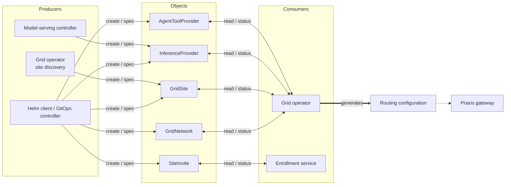

# CRD Ownership

Who writes and consumes AI Grid Network (AGN) objects. All installed CRDs use
grid.praxis.fast/v1alpha1 and are cluster-scoped.

## Producers and consumers

Helm/GitOps applies administrator configuration. Site discovery and reconciliation
are roles within the same grid-operator process. Bidirectional arrows show a
controller reading an object and writing its status.

## Object index

| Object | Created by | Spec writer | Status writer / direct consumer |
| --- | --- | --- | --- |
| [GridNetwork](grid-network.md) | Helm client or GitOps controller | Helm/GitOps | Grid operator |
| [GridSite](grid-site.md) | Helm/GitOps for declared sites, Grid operator for discovered sites | Creator for that mode | Grid operator |
| [InferenceProvider](inference-provider.md) | Helm/GitOps or model-serving controller | Publishing component | Grid operator |
| [AgentToolProvider](agent-tool-provider.md) | Helm client or GitOps controller | Helm/GitOps | Grid operator |
| [SiteInvite](site-invite.md) | Administrator API client or Helm/GitOps | Immutable after creation | Enrollment service |

[AgentToAgentProvider](agent-to-agent-provider.md) is schema-only: it is absent
from the generated CRD installation and has no runtime controller or consumer.

## Ownership rules

The table names API writers. An administrator can also create resources directly
through an API client. The operator chart can render GridNetwork, but the running
Grid operator does not create it or populate missing TLS references.

- **Owner** means the authority for the desired values, not necessarily a
  Kubernetes ownerReference. Helm and GitOps apply administrator intent.
- Edit administrator-owned specs in their source configuration. For generated
  objects, edit the producing controller's input.
- Controllers maintain status and generated outputs on events and periodic
  reconciliation. Reconciliation does not rewrite every spec on a fixed interval.
- RBAC and admission control write access. Ownership alone does not prohibit
  administrator edits.

The gateway consumes generated routing configuration. It does not watch these
CRDs directly. See the [field reference](../crds.md) for API fields and examples.
