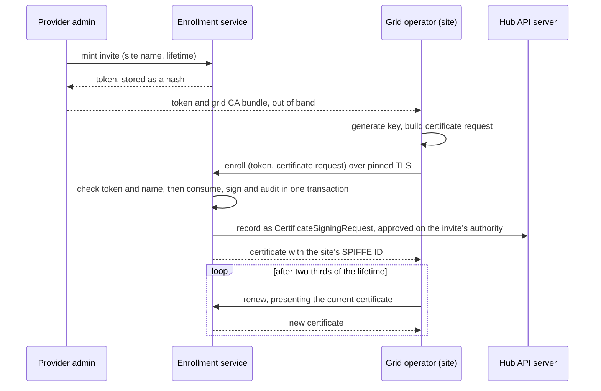

# Enrollment

Enrollment is how a cluster, from then on a site, gets its grid identity: a
name the grid assigned and a certificate the grid CA signed. This page covers
the flow across the enrollment service, the grid operator and the provider
admin, and what each hop trusts. [Site Enrollment](../installation/enrollment.md) is
the install procedure. [Authentication and Access Policy](auth.md) covers what
the certificate is used for once a site has one.

## Personas

| Persona | Who | Part in enrollment |
| --- | --- | --- |
| Provider admin | The provider's operations team, holding the grid-admin role on the hub | Mints and revokes invites, and so decides which sites may join |
| Tenant admin | An enterprise customer's platform team | None. A tenant never enrolls a site |
| Tenant user | A developer or an application | None |

## Components

| Component | Runs | Holds |
| --- | --- | --- |
| Enrollment service | The hub, the cluster that runs the grid's shared services, or standalone outside any cluster | The grid CA, invite hashes, the enrollment records |
| Grid operator | Every site | The site key, in a Secret only it reads |

Sites talk to the enrollment service over HTTPS and never to the hub's API
server. The hub's own cluster is also a site. Its name is reserved, and its
identity is issued by the service's bootstrap step, the one that also creates
the grid CA, not by enrollment.

## Flow



1. Mint. The provider admin mints a single-use invite, a token pinned to a site
   name, with a lifetime of at most seven days. The service stores only the
   token's hash. Minting is the admission decision.
2. Carry. The token and the grid CA bundle reach the joining site out of band,
   as Secrets in the operator's namespace. The operator config's `site` section
   names them: `inviteSecretRef` the token, `signerEndpoint.caBundleRef` the CA
   bundle, and `signerEndpoint.url` the service.
3. Join. The operator generates a key that never leaves the cluster, builds a
   certificate request, and posts it with the token to the service over a
   connection it verifies against the pinned CA bundle. The GridSite's
   `Enrolled` condition reports the result.
4. Check. The service checks the token before parsing the request: the token
   must hash to a live, unspent invite. The name must not be enrolled already
   and must not be reserved. The site receives a refusal immediately.
5. Issue. Consuming the invite, signing the certificate and writing the audit
   record are one transaction, so an invite is spent if and only if a
   certificate is issued. The name on the certificate is the invite's pin,
   never the request's subject. The certificate carries the site's SPIFFE ID
   and lives 180 days by default.
6. Renew. Once two thirds of the lifetime has passed, the operator requests a
   new certificate from the signer the operator config names, presenting its
   current one as proof, unless `site.signerEndpoint.rotation` is `Disabled`.
   The grid-operator chart renders that config, on the hub as on a joining
   site, and renewal reads nothing else. The service refuses a
   renewal that reuses a key already on the site's record, names an unknown
   site, or does not match the site's record, for example a certificate issued
   before the site's current enrollment.

Enrollment grants identity, not liveness. The gossip mesh the GridNetwork
configures carries which sites are live, and each member's GridSite converges
to Active through it, as [Custom Resource Definitions](crds.md) describes.

## Trust boundaries

| Who trusts whom | What is trusted | How |
| --- | --- | --- |
| Site trusts service | The service's identity | The CA bundle pinned on the site |
| Service trusts site, join | That the request came from an invite holder | The token's hash, single use |
| Service trusts site, renewal | That the requester holds the site's identity | The current certificate, verified against the grid CA and the site's record |
| Peer trusts peer | A member's identity | The site certificate chains to the grid CA and names the site |

The service signs and never decides who may ask. The provider admin decides who
may ask and never signs. The site holds its key and never sees the CA key.

## Failure and expiry

| Event | What happens |
| --- | --- |
| Invite expires unused | The service refuses it. The provider admin mints again |
| Invite revoked | The service refuses it from then on |
| Request refused | The operator reports the reason. Only a new invite lets it try again |
| Service unreachable | The operator retries with backoff and reports it |
| Renewal refused | The site keeps serving on its current certificate until it expires |

## CertificateSigningRequests

Enrollment will adopt the Kubernetes CertificateSigningRequest as its record and
approval object. The kubelet, Open Cluster Management and cert-manager approve
the same object for the same job, and it brings the `approve` verb scoped by
signer name, `kubectl certificate approve` and `deny`, Approved and Denied
conditions only the approval subresource can set, the request in an immutable
field, and the API
server's audit log. Sites still talk only to the enrollment service, which
creates the request on the hub on their behalf, off the request path, so a
slow API server never delays a site's response. It lands in three steps, in
order. The first ships; the other two are planned.

What the service creates for an accepted request:

```yaml
apiVersion: certificates.k8s.io/v1
kind: CertificateSigningRequest
metadata:
  name: west-9f86d081884c7d659a2feaa0c55ad015   # site name and enrollment id, so a retry names the same record
  labels:
    grid.praxis.fast/site-name: west           # for listing only; labels are writable
spec:
  signerName: grid.praxis.fast/site            # the chart's csrRecord.signerName; one per service on a cluster
  request: <the site's PKCS#10>                # the one request block, under the PEM label the API server parses
  usages: [digital signature, server auth, client auth]   # what the issued leaf carries
status:
  certificate: <issued by the service>
  conditions:
    - type: Approved
      status: "True"
      reason: InviteRedeemed
      message: issued on the single-use invite's authority
```

No `expirationSeconds`: it is a request to the signer, and the signer has already
decided the lifetime, which the issued certificate carries. The API server sets
the condition timestamps. The name the grid trusts is in none of the mutable
fields: it is the SPIFFE name in `status.certificate`, which the service pinned
from the invite, and the Approved condition is not proof of issue either, since
an approver can deny before the service approves. A reader treats
`status.certificate` as the fact. Anyone who can list requests on the hub can
read the last hour of enrollments, site names and public keys included, which
were database-only before.

1. Record, shipped. Every accepted enrollment becomes a request under the
   configured signer name, approved by the service with reason InviteRedeemed
   and completed with the issued certificate, after the issuing transaction
   commits. The flow does not change and the record never gates issue: it is
   written off the request path within a deadline, a failed record is logged,
   and the certificate stands. Two admission policies ship with it: one refuses
   the signer name from any principal that is not the service, which stops
   ordinary request creators and accidents but not a principal able to act as
   the service account; the other confines the service to its own signer name,
   so a compromised service cannot file, approve or complete requests under
   any other signer. Each service on a cluster has its own signer name.
   Standalone mode, with no cluster, keeps no record. A record in flight when
   the service stops is dropped.
2. Manual approval, planned. An invite can ask for a person's decision. For such an
   invite the service creates the request and waits for Approved instead of
   approving it. The `approve` verb on `grid.praxis.fast/site` is then held by
   people only and the service keeps `sign`, so the principal that files can
   never admit. Before approving, the provider admin compares a key code, the
   first sixteen hex digits of the SHA-256 of the public key in `spec.request`,
   with the code the joining site's operator reports. The code is computed from
   the request, never stored, since an annotation is writable by anyone with
   update on the object. Denied reaches the site on its next poll.
3. Renewals, planned. A renewal becomes a request under `grid.praxis.fast/site-renewal`,
   approved by the service on proof of the current certificate, so enrollments
   and renewals share one audit trail with different approvers.

The API server removes a pending request after 24 hours, and an approved and
issued one about an hour after approval, whatever the certificate's lifetime.
`kubectl get csr` is therefore a one-hour window on recent enrollments, not a
ledger. The durable trail is the service's own enrollment record, and the API
server's audit log when its policy covers these writes at Request level or
above with a persistent backend.

## Direction

The flow above ships, driven by chart values and a Job that mints invites.
In Kubernetes, the enrollment service reconciles SiteInvite objects into
token Secrets and revokes unused tokens when an admin deletes an invite.
Standalone enrollment keeps its existing flow. The service enforces an optional
key binding, but jurisdiction assignment and the approval gate remain pending.
Redemption still issues immediately. See
[SiteInvite usage](crds.md#siteinvite).
