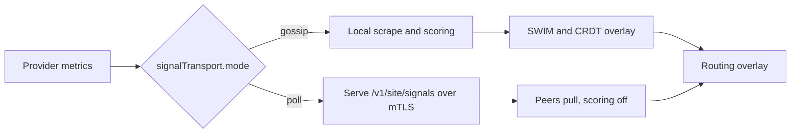

# Signal propagation

Signals are the provider load a site observes, such as queue depth and KV-cache
pressure. `signalTransport` on the `GridNetwork` selects, grid-wide, how they
cross sites. It names the dissemination path, not the transport: SWIM membership
runs either way and only where the load signal travels changes, which is why the
modes are `gossip` and `poll` rather than `swim`.



```yaml
signalTransport:
  mode: poll
```

`gossip` is the established path: each site scrapes and scores locally and the
samples ride the SWIM and CRDT overlay. `poll` instead serves the scraped
signals on a mutual-TLS `/v1/site/signals` endpoint, polls peers, and turns
local scoring off so the gateway ranks from what it pulls. A peer's poll URL is
its SWIM-advertised host at the signals port, so a reachable member is a
reachable signals endpoint.

The field is optional. Absent, the grid gossips, so existing deployments are
unaffected. The mode is read once at operator start, so changing it is a
restart, not a live flip, which keeps the mTLS listener bound only under `poll`.
When a `GridNetwork` declares another mode than the running one, for example
one created after the operator started, the operator exits so Kubernetes
restarts it into the declared mode. Only the poll path restarts on a peer trust
change, so a trust change under `gossip` does not restart it. Certificate rotation
reads the declared trust on every check, so under `gossip` a switch to `pin` stops
it without a restart. Under `poll` the same change restarts the operator.

At Tech Preview one operator serves one `GridNetwork`, and it fails to start on
more than one rather than pick a mode for the process-global serve and poll
paths. A reader treats a missing signal as neutral, not zero, per the signal
mapping reference.

Peers are dialled directly. The signals and providers path reads no
`HTTP_PROXY`, `HTTPS_PROXY` or `NO_PROXY`, so a proxy between sites must pass
TLS through untouched, and an egress proxy that terminates TLS breaks the
mutual TLS the path depends on.

## Gateway ingest feedback

The local gateway reports completed ingests with an empty-body
`POST /v1/site/signals/ingest` on the same authenticated signals listener. The
server accepts only the site's own certificate (`Local`), in both pin and SPIFFE
modes. A remote peer cannot submit gateway evidence. The report's replica label
is diagnostic; the TLS connection supplies authorization.

Version 1 uses exactly one value for each of these headers:

| Header | Value |
|---|---|
| `x-grid-ingest-version` | `1` |
| `x-grid-ingest-replica` | 1-128 ASCII letters, digits, dots, underscores, or hyphens |
| `x-grid-ingest-epoch` | 32 lowercase hexadecimal characters from a random process identity |
| `x-grid-ingest-sequence` | Positive signed 64-bit report sequence |
| `x-grid-ingest-skew` | Non-negative signed 64-bit cumulative skew-drop count |
| `x-grid-ingest-rejected` | `true` or `false` |

The maximum sequence or counter is reserved for terminal rejected evidence;
it cannot carry a clean report. Malformed, repeated, unsupported, or oversized
metadata and nonempty bodies are refused. The entire server operation has a
five-second budget, including body reading, admission, and Kubernetes writes.

Local callers share the listener's connection limit. The limit fits every
declared member's connections plus eight for local traffic and 64 for
handshakes, at least 256 and at most 4096, and `grid_signals_connection_cap`
reports it. It grows as members are declared and never shrinks while the
listener runs. Peers can never hold the local or handshake slots. A source
holds at most half of the handshake slots, and at its cap the newest handshake
is refused. Past 4096 the listener sheds connections and counts them in
`grid_signals_connections_shed_total{limit="total"}`. The site's own certificate remains
the trust boundary; feedback has no separate local quota, and its single writer
serializes publication within the same request budget.

`grid_gateway_feedback_events_total{event}` counts `conflict` for each Kubernetes
`409` resource-version race, `conflict_exhausted` after all three attempts,
`overflow` when persisted reporter capacity refuses a new identity,
`unauthorized` when a non-local caller submits feedback, and `write_failure`
for other Kubernetes write errors or unverified storage responses. Labels never
include reporter identities, request metadata, or error strings.

A `204` response echoes `x-grid-ingest-epoch` and `x-grid-ingest-sequence` only
after the report and resulting condition have been persisted together. A
counter increase establishes rejection even when the flag claims clean. A
strictly newer clean report with the same cumulative counter clears only that
process's evidence. Exact duplicates are idempotent and do not renew freshness;
replays, changed duplicates, and decreasing counters are refused.

Older gateways continue their GET-only polling. Older operators refuse the POST
without acknowledging it. Polling remains available in either mixed-version
case, but gateway conditions require both components and the updated
GridNetwork CRD. The gateway retains unacknowledged evidence while feedback is
unsupported or unavailable.
