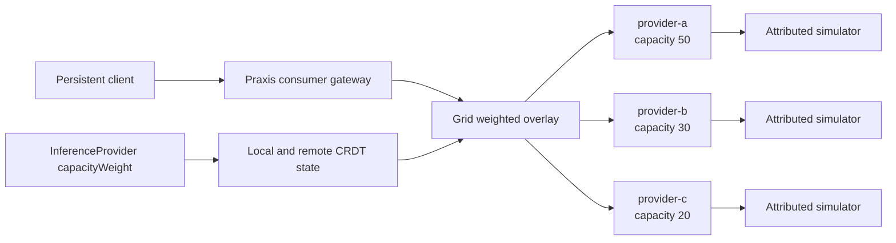
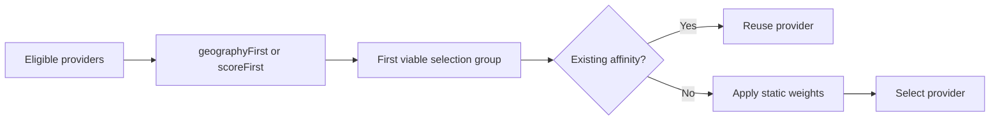

# Static weighted provider qualification

This isolated three-site Forge topology qualifies operator-configured relative
provider capacity without changing the ordinary `grid-provider-traffic`
round-robin qualification. Static weighting is not queue-depth, KV-cache, or
other live-metric routing: it has no scraping, normalization, smoothing,
hysteresis, availability floor, or recovery timer.



AGN applies capability, authorization, trust, health, freshness, and admission
checks before it forms selection groups. With `geographyFirst`, the closest
viable locality tier is active and remote tiers remain fallback; with
`scoreFirst`, eligible providers from different sites can share the active
group. Praxis reuses a permitted affinity binding first and performs the
weighted draw only for new, unbound requests inside the first viable group.
Relative weights are not percentages or request guarantees. This qualification
uses sessionless samples so affinity does not turn a random distribution into a
sticky sequence; affinity behavior itself remains unchanged.



The policy is represented by:

```yaml
selectionPolicy:
  mode: weightedRandom
placementPolicy:
  strategy: static
```

Each `InferenceProvider.spec.capacityWeight` is a positive relative capacity;
`1` is the backward-compatible default. The three phases are:

1. Baseline `50/30/20`, rendered directly as `50/30/20`.
2. Changed `20/30/50`, rendered directly as `20/30/50` and requiring a new semantic
   revision without a gateway restart.
3. Equal `1/1/1`, rendered as equal weights and requiring another revision
   without a restart.
4. Verify a repeated `X-Session-Id` request stays assigned to its original
   provider, then withdraw all three providers in sequence. The runner records
   every published revision, waits for the empty revision to appear in the
   gateway's mounted file, then requires Praxis to accept and serve that same
   revision without restarting. New and affinity-bound requests must return 404
   without provider attribution or backend/provider-gateway contact. Restoring
   provider-a must publish and serve a new revision and route attributed traffic
   again.

Before every sample, the runner records configured capacity, local and remote
CRDT state, rendered weights, and Grid/Praxis revisions. Traffic starts only
after two stable observations satisfy:

```text
Grid semantic revision == Praxis accepted revision == Praxis serving revision
```

Every request uses one persistent restricted client pod and records its ordinal,
status, selected provider, latency, attempts, and every transport-only retry.
Received HTTP errors and attribution mismatches are never retried. Statistical
acceptance uses a Pearson chi-square goodness-of-fit test with two degrees of
freedom and critical value `5.991` at `alpha = 0.05`. Random sampling can vary;
the test evaluates the complete distribution rather than requiring exact
percentages.

## Run the qualification

The qualification requires Docker, Kind, `kubectl`, Helm, OpenSSL, Cargo, and
a compatible Praxis AI gateway image. Run it in a dedicated checkout and do
not run concurrent Forge qualifications that share the same state or resource
names.

The triggered GitHub qualification uses the published
`ghcr.io/praxis-proxy/ai:0.7.0` image, pinned by its OCI index digest in the
workflow. The local source-validation instructions below deliberately build a
Praxis AI image from the companion checkout and pass it as an explicit image
override.

For source validation, build the Grid operator from this checkout and build a
Praxis AI gateway image that supports empty versioned routing snapshots from
its repository. The checked-in topology defaults to the released AI 0.6.0
image; triggered CI pins it to
`sha256:45e7f510ad40ffc41b7dadfa0feabd0d201ce43e75f8bd1ebee6c2f020f7f3e3`:

```console
# From the Grid repository root.
cargo build -p forge
IMAGE_TAG="grid-static-weighted-$(date -u +%Y%m%d%H%M%S)"
docker build -f deploy/operator/Containerfile -t "grid-operator:${IMAGE_TAG}" .
docker build -f crates/overlay-sync/Containerfile -t "grid-overlay-sync:${IMAGE_TAG}" .

# From the compatible Praxis AI repository root.
docker build -f Containerfile -t "praxis-ai:${IMAGE_TAG}" .
```

The standard `ghcr.io/praxis-proxy/ai:0.7.0` image is compatible with Grid's
authoritative empty versioned no-route snapshots. Use AI 0.6.0 or a Praxis build
that supports them; the qualification must remain failed while the configured
image lacks that support.

Materialize the simulator and select the images explicitly. With
`GRID_XTASK_IMAGE_PULL_POLICY=Never`, every selected image must be present in
the local container store so the runner can load it into the run-owned Kind
clusters:

```console
docker pull ghcr.io/llm-d/llm-d-inference-sim@sha256:7f3a1f72875c5dd5d00299ad358dc1f6e17041a5124609a43aa17ad318bbed32
docker tag ghcr.io/llm-d/llm-d-inference-sim@sha256:7f3a1f72875c5dd5d00299ad358dc1f6e17041a5124609a43aa17ad318bbed32 ghcr.io/llm-d/llm-d-inference-sim:v0.10.2

export GRID_XTASK_OPERATOR_IMAGE="grid-operator:${IMAGE_TAG}"
export GRID_XTASK_GATEWAY_IMAGE="praxis-ai:${IMAGE_TAG}"
export GRID_XTASK_OVERLAY_SYNC_IMAGE="grid-overlay-sync:${IMAGE_TAG}"
export GRID_XTASK_SIM_IMAGE=ghcr.io/llm-d/llm-d-inference-sim:v0.10.2
export GRID_XTASK_IMAGE_PULL_POLICY=Never

EVIDENCE_DIR="$(mktemp -d)"
cargo xtask env run-grid-static-weighted-qualification \
  --forge-config tests/e2e/topologies/grid-static-weighted/forge.yaml \
  --quick --teardown \
  --evidence-dir "$EVIDENCE_DIR"
```

Registry-hosted images may be used with immutable references and
`GRID_XTASK_IMAGE_PULL_POLICY=IfNotPresent`; set all image overrides to the
registry references in that case. Do not mix a local source image with an
unrelated registry image when validating one source revision.

The qualification records structured evidence for the selected source
revision. Each execution owns only the resources it creates, and teardown
removes those run-owned resources. For failures, compare configured, local,
remote, and rendered weights, then the published revision, mounted revision,
Praxis accepted/serving revisions, and gateway identity before changing
timeouts. The ordinary round-robin qualification remains the compatibility
check for non-weighted routing.
